<div align="center">
  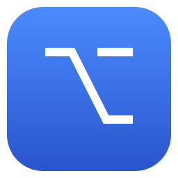
  <h1>SwitchMux</h1>
  <p>macOS 原生应用与窗口快速切换器 · 全局热键 · App 快速栏 · 窗口缩略图切换</p>
  <p>
    
    
    
  </p>
</div>

按住 ⌥ Option，一条半透明快速栏即可启动 / 切换 / 隐藏应用；⌘Tab 在所有窗口的实时缩略图之间切换，⌥` 在同一应用的多个窗口之间切换。常驻菜单栏，原生 Swift / AppKit 实现，无需完整 Xcode，一条命令即可构建。

<p align="center">
  <a href="docs/media/switchmux-promo.mp4">
    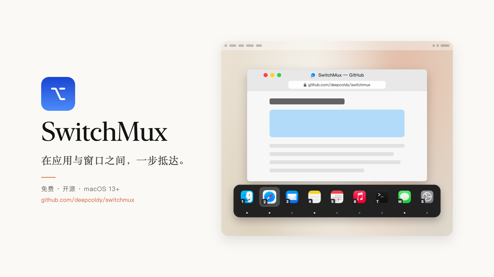
  </a>
  <br><sub>▶ 点击观看 40 秒介绍视频</sub>
</p>

## 下载安装

1. 从 [Releases](https://github.com/deepcoldy/switchmux/releases/latest) 下载 `SwitchMux.dmg`（已签名并经 Apple 公证）。
2. 打开 DMG，把 SwitchMux 拖到「应用程序」。
3. 从「应用程序」打开 SwitchMux，欢迎向导会依次引导：安装位置 → 辅助功能授权（必需）→ 屏幕录制（可选，用于缩略图）→ 快捷键速览。

直接在 DMG 里双击运行也没关系：SwitchMux 会提示并自动把自己移到「应用程序」后重新打开（放在磁盘映像里时授权无法保留，自动更新也无法替换）。之后的版本通过内置的自动更新安装。

<p align="center">
  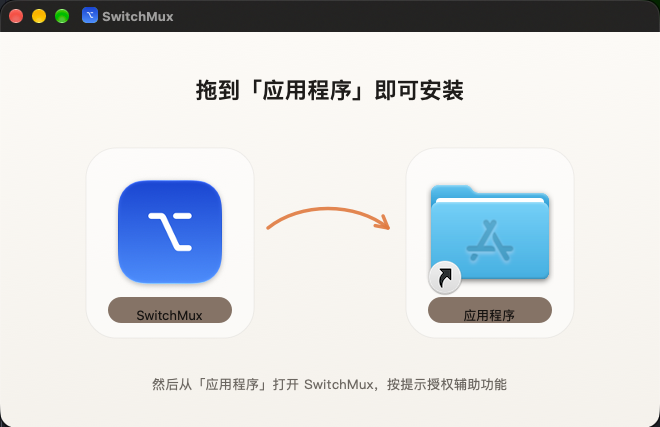
</p>

## 截图

**应用快速栏（App Bar）** —— 按住热键浮现，图标角标即触发键，松开或按数字切换：

<p align="center">
  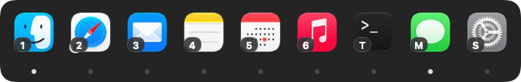
</p>

**窗口缩略图切换器** —— 按住 ⌘Tab 唤起（快速按一下直接切到上一个窗口），Tab / 方向键 / 数字导航，Q/W/H/M 快捷动作：

<p align="center">
  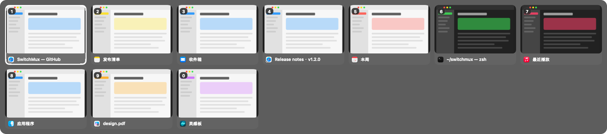
</p>

**首次启动向导** 与 **吸附在系统设置下方的授权浮窗**（把图标直接拖进列表，授权后立即生效，无需重启）：

<p align="center">
  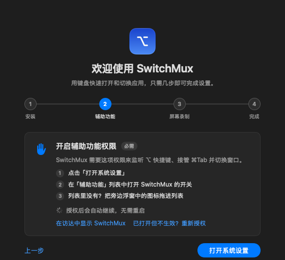
  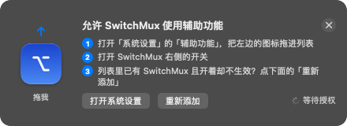
</p>

**应用** 与 **应用栏**（一个应用列表：Finder / Dock / 运行中 / 拖入添加，拖动排序，逐个录制按键；激活键、显示时机与外观）：

<p align="center">
  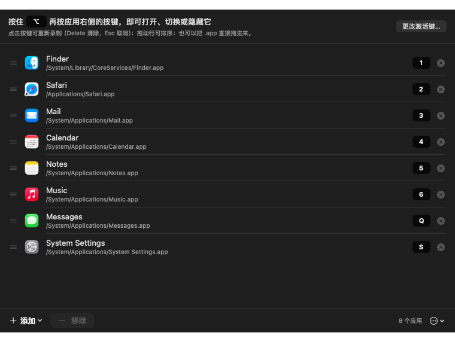
  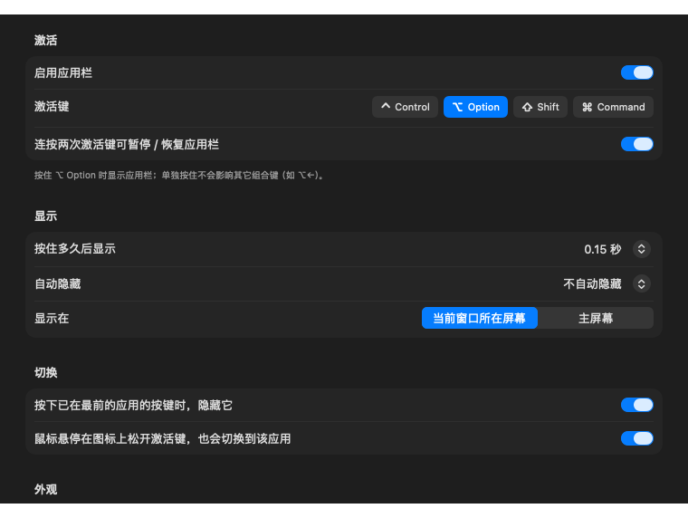
</p>

<details>
<summary>更多界面：窗口切换 / 通用 / 例外 / 统计</summary>
<p></p>
<p align="center">
  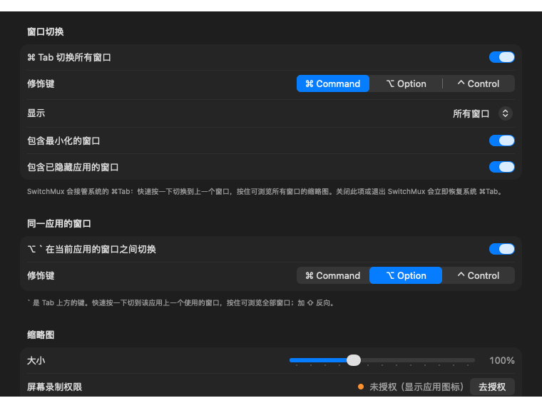
  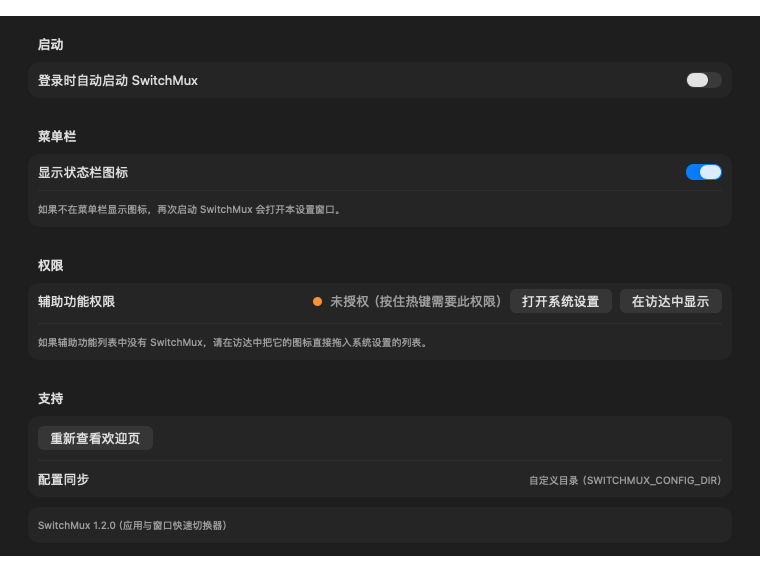
  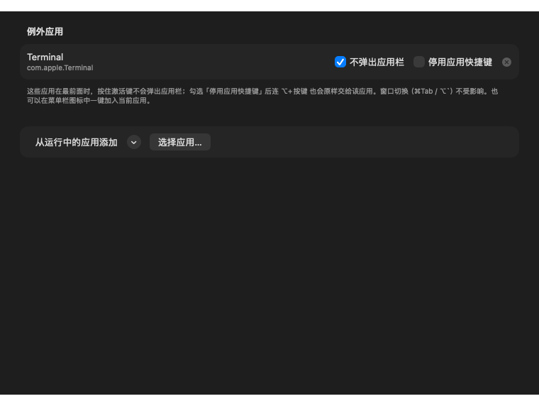
  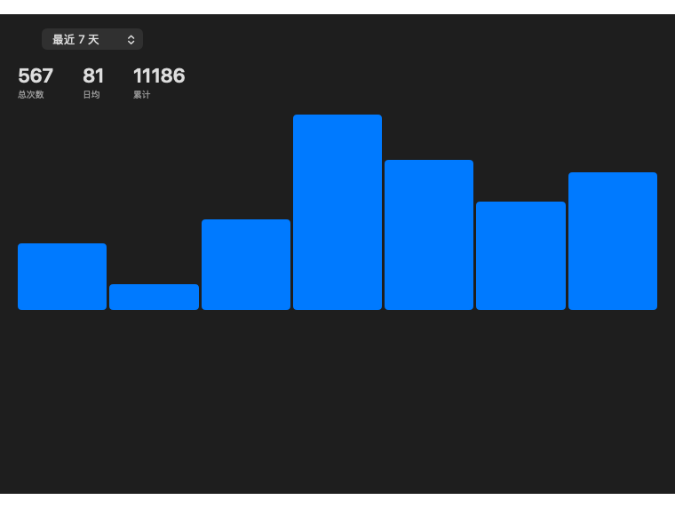
</p>
</details>

## 功能

### 应用快速栏

- **全局激活热键**：默认 ⌥ Option，可任意组合 ⇧ ⌃ ⌥ ⌘。
- **毛玻璃浮条**：应用图标、触发键角标、运行指示点、当前应用高亮边框、悬停高亮、淡入淡出。
- **一个应用列表**：添加 Finder、导入 Dock 中的应用（全部或单个）、从运行中的应用 / 应用程序文件夹选择，或直接拖入 .app；拖拽排序，逐个录制按键（Delete 清除，Esc 取消），一键按顺序重新分配；可导入导出。首次启动默认载入 Finder + Dock 应用。
- **切换语义**：未运行则启动；已在最前则隐藏；已隐藏则取消隐藏；否则置前激活（行为同点击 Dock 图标）。
- 悬停松开即切换；连按两次激活键临时停用 / 启用；显示延迟含 **从不**（纯盲按快捷键）。
- **例外应用**：指定应用在前台时不弹出快速栏，或仅停用快捷键。

### 窗口缩略图切换器

- **⌘Tab**：接管系统 ⌘Tab（参考 alt-tab 的实现：关闭系统符号热键并以 Carbon 热键注册，退出 / 崩溃 / 关闭该功能时自动恢复）。快速按一下切到上一个窗口、不闪界面；按住才显示缩略图。修饰键可改为 ⌥ / ⌃，此时系统 ⌘Tab 保持不变。
- **⌥`**：在当前应用的多个窗口之间切换（` 为 Tab 上方的键，⇧ 反向），修饰键可改。
- **导航**：Tab / ⇧+Tab、方向键、数字 1–0 直达、鼠标移动选择；松开或回车激活，Esc 取消。
- **动作**：Q 退出、W 关窗、H 隐藏、M 最小化。
- **顺序**：按最近使用排列（屏幕上的窗口按 WindowServer 层级，其余按应用最近使用）；范围可选所有窗口 / 当前桌面 / 当前应用，可含最小化与已隐藏应用窗口。
- 窗口在后台线程枚举（每个应用 0.25 s AX 超时、并行），通过 SkyLight 私有接口前置并聚焦指定窗口，macOS 14+ 也能可靠切换。
- **授权屏幕录制后显示真实缩略图；截图由内置子进程完成，授权后免重启生效**；未授权时用应用图标。

### 其他

- 从 1.1 及更早版本升级时自动迁移：当前启用的自定义配置成为应用列表；若当前为 Dock 模式则转为 Dock 中的应用。写出的配置仍兼容旧版本（共享 iCloud 配置的其它 Mac 不受影响）。
- 用量统计：按天记录，柱状图查看今天至一年内任意区间。
- 外观：大小 70%–140%、不透明度、边框粗细、垂直 / 水平位置。
- **配置自动同步**：设置存为单个 `config.json`，默认写入 iCloud Drive 目录自动多设备同步，本地保留镜像并热重载；与签名 / 二进制名无关，重新构建不丢配置。
- 菜单栏图标与菜单、登录自启、分步欢迎向导与实时权限引导；从 DMG / 下载文件夹打开时自动移到「应用程序」。

## 构建

只需 Command Line Tools（无需完整 Xcode）：

```bash
git clone https://github.com/deepcoldy/switchmux.git
cd switchmux
./build.sh
open build/SwitchMux.app
```

产物为通用二进制（arm64 + x86_64），最低系统 macOS 13。

首次运行需在 **系统设置 → 隐私与安全性** 授权：

- **辅助功能**（必需）：全局热键与窗口操作。欢迎向导一键打开设置，并在系统设置窗口下方吸附一个浮窗，把其中的图标拖进列表即可；授权后立即生效、无需重启。
- **屏幕录制**（可选）：仅用于窗口缩略图，不授权也可正常切换。

临时签名的本地构建会被系统当作另一个应用，每次重新构建都要再授权一次。有 Developer ID 证书时运行一次 `scripts/sign-local.sh --save-password`，之后 `./build.sh` 会自动用证书签名，授权得以保留（见 [docs/RELEASING.md](docs/RELEASING.md)）。

打包安装 DMG（与 CI 相同）：`scripts/make_dmg.sh build/SwitchMux.app build/SwitchMux.dmg`。

## 测试

```bash
Tests/run.sh   # 配置迁移、按键绑定、新旧配置兼容性
```

## 代码结构

```
Sources/
  main.swift                 程序入口
  App/                       AppDelegate、状态栏菜单、权限引导浮窗
  Model/                     配置模型与设置存储（JSON + iCloud Drive 同步）
  Services/                  事件监听（独立线程）、Carbon 热键、热键状态机、私有 API、Dock 读取、应用监控
  AppBar/                    应用快速栏
  WindowSwitcher/            窗口枚举、缩略图切换器、窗口动作、截图权限
  CaptureHelper/             截图子进程（通用二进制，内置在 .app 内）
  Preferences/ · Panes/       设置窗口与各设置面板
  Welcome/                   欢迎页
scripts/                     图标生成脚本
```

## 许可证

MIT License —— 详见 [LICENSE](LICENSE)。
