<div align="center">
  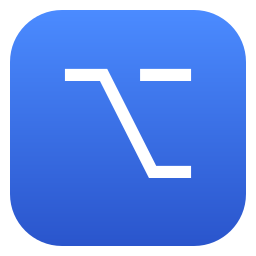
  <h1>SwitchMux</h1>
  <p>macOS 原生应用与窗口快速切换器 · 全局热键 · App 快速栏 · 窗口缩略图切换</p>
  <p>
    
    
    
  </p>
</div>

按住 ⌥ Option，一条半透明快速栏即可启动 / 切换 / 隐藏应用；按住 ⌘ 再按 Tab，在所有窗口的实时缩略图之间切换。常驻菜单栏，原生 Swift / AppKit 实现，无需完整 Xcode，一条命令即可构建。

## 截图

**应用快速栏（App Bar）** —— 按住热键浮现，图标角标即触发键，松开或按数字切换：

<p align="center">
  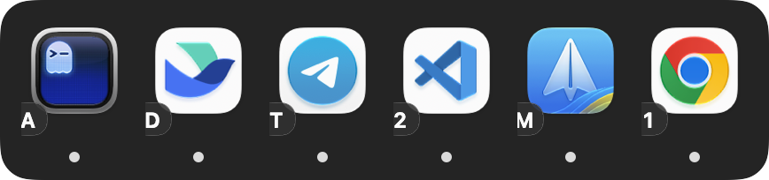
</p>

**窗口缩略图切换器** —— ⌘+Tab 唤起，Tab / 方向键 / 数字导航，Q/W/H/M 快捷动作：

<p align="center">
  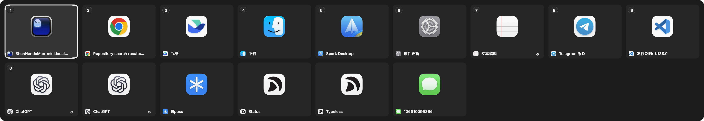
</p>

**首次启动权限引导** 与 **系统设置旁的悬浮指引**（授权后立即生效，无需重启）：

<p align="center">
  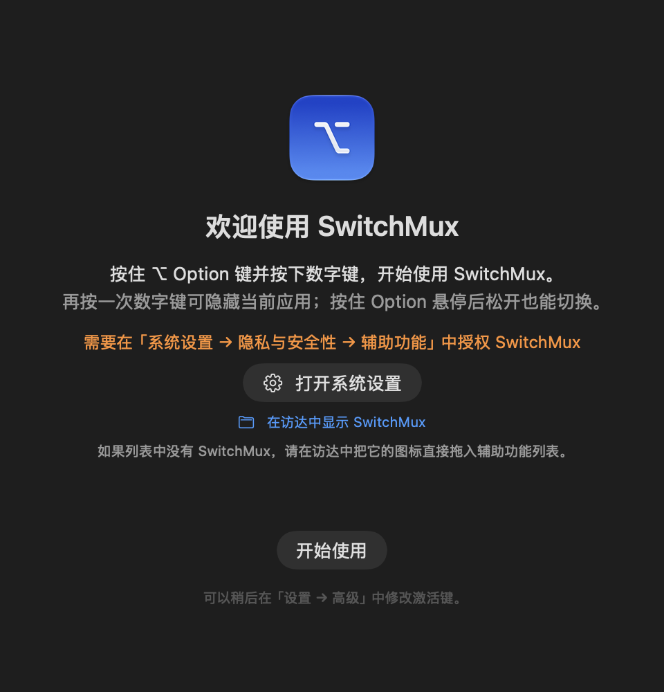
  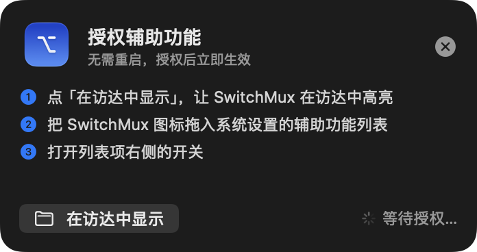
</p>

**配置管理** 与 **自定义应用**（三种模式、导入导出、拖入 / 从 Dock 载入、逐个录制快捷键）：

<p align="center">
  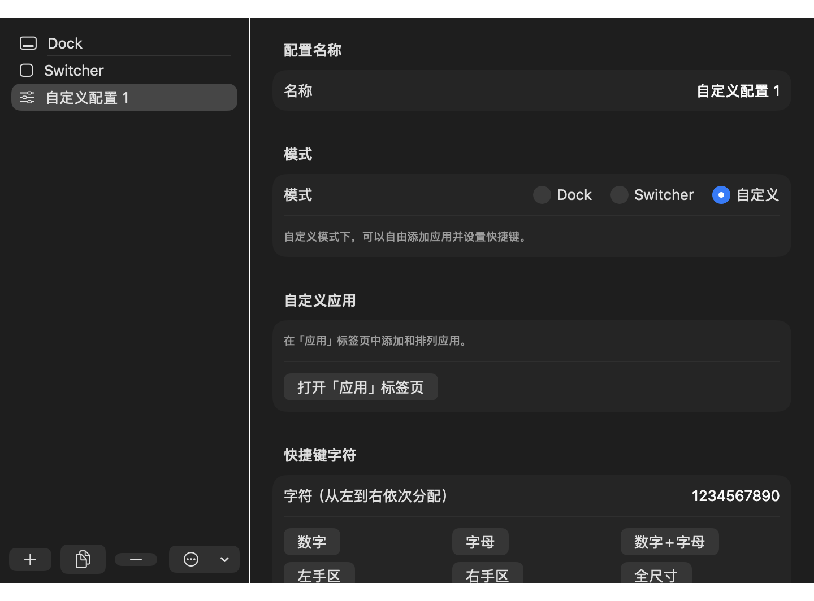
  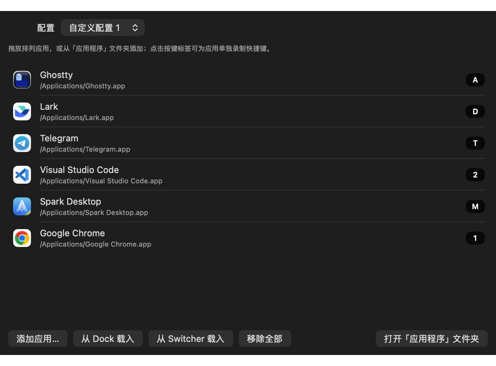
</p>

**窗口切换设置** 与 **外观**（热键、范围、缩略图、大小 / 透明度 / 位置）：

<p align="center">
  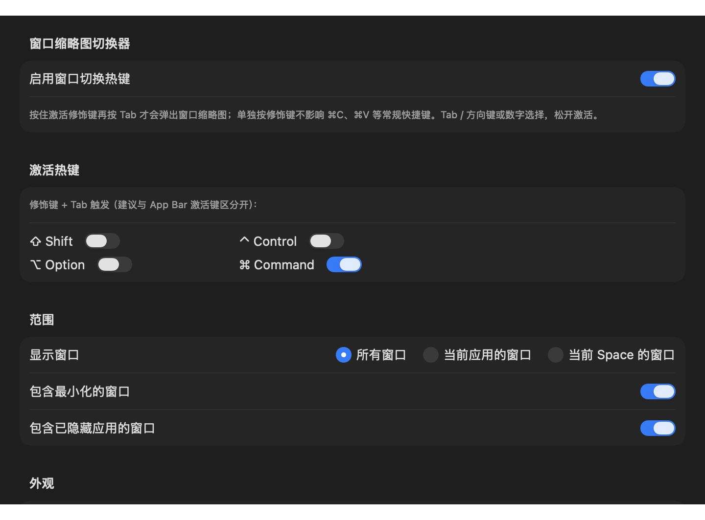
  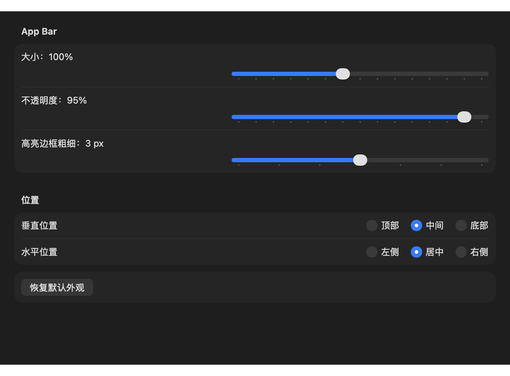
</p>

<details>
<summary>更多界面：通用 / 高级 / 静默模式 / 用量统计</summary>
<p></p>
<p align="center">
  
  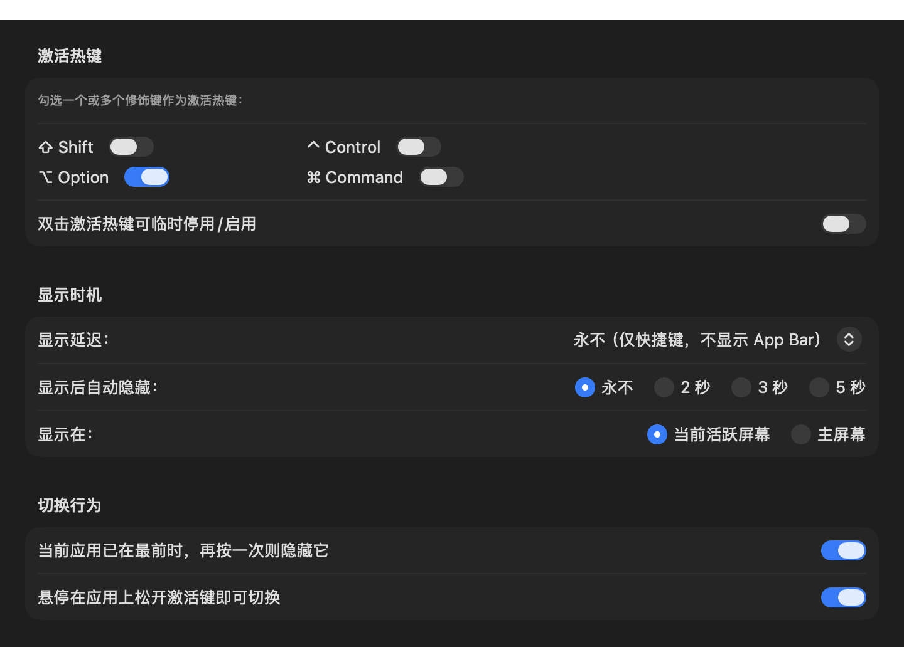
  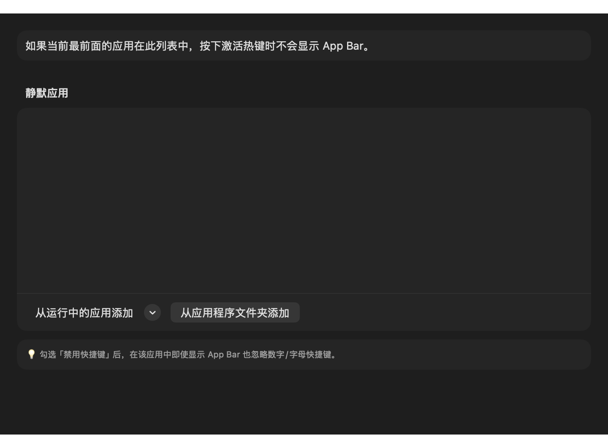
  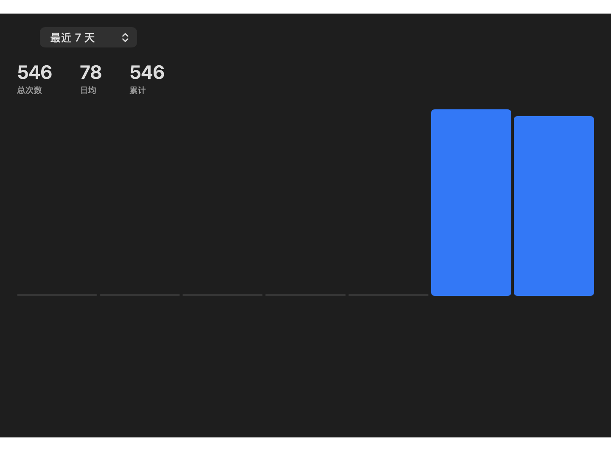
</p>
</details>

## 功能

### 应用快速栏

- **全局激活热键**：默认 ⌥ Option，可任意组合 ⇧ ⌃ ⌥ ⌘。
- **毛玻璃浮条**：应用图标、触发键角标、运行指示点、当前应用高亮边框、悬停高亮、淡入淡出。
- **三种配置模式**
  - **Dock**：与 Dock 中的应用一致，可选 Finder 置顶。
  - **切换器**：按最近使用顺序排列，可过滤指定应用。
  - **自定义**：自由添加应用（选择 / 从 Dock / 从运行中应用 / 拖入）、拖拽排序、逐个录制快捷键。
- **切换语义**：未运行则启动；已在最前则隐藏；已隐藏则取消隐藏；否则置前激活。
- 悬停松开即切换；双击热键临时停用 / 启用；显示延迟含 **永不**（纯盲按快捷键）。
- **静默模式**：指定应用在前台时不弹出快速栏，或仅禁用快捷键。

### 窗口缩略图切换器

- **⌘+Tab 唤起**：按住修饰键再按 Tab 才弹出（单独按 ⌘ 不触发，不影响 ⌘C / ⌘V），热键可自定义。
- **导航**：Tab / ⇧+Tab、方向键、数字 1–0 直达、鼠标悬停；松开或回车激活，Esc 取消。
- **动作**：Q 退出、W 关窗、H 隐藏、M 最小化。
- **范围**：所有窗口 / 当前应用 / 当前 Space；可含最小化与已隐藏应用窗口；缩略图大小可调。
- 以辅助功能 API 精确枚举标准窗口、识别最小化并前置指定窗口。
- **授权屏幕录制后显示真实缩略图；截图由内置子进程完成，授权后免重启生效**；未授权时用应用图标。

### 其他

- 多配置：新建 / 重命名 / 复制 / 删除 / 导入 / 导出（JSON）。
- 用量统计：按天记录，柱状图查看今天至一年内任意区间。
- 外观：大小 70%–140%、不透明度、边框粗细、垂直 / 水平位置。
- **配置自动同步**：设置存为单个 `config.json`，默认写入 iCloud Drive 目录自动多设备同步，本地保留镜像并热重载；与签名 / 二进制名无关，重新构建不丢配置。
- 菜单栏图标与菜单、登录自启、欢迎页与实时权限引导。

## 构建

只需 Command Line Tools（无需完整 Xcode）：

```bash
git clone https://github.com/deepcoldy/switchmux.git
cd switchmux
./build.sh
open build/SwitchMux.app
```

产物为通用二进制（arm64 + x86_64），最低系统 macOS 13。

首次运行需在 **系统设置 → 隐私与安全性** 授权：

- **辅助功能**（必需）：全局热键与窗口操作。欢迎页可一键打开设置并在访达中高亮应用，直接拖入列表；授权后立即生效、无需重启。
- **屏幕录制**（可选）：仅用于窗口缩略图，不授权也可正常切换。

## 代码结构

```
Sources/
  main.swift                 程序入口
  App/                       AppDelegate、状态栏菜单、权限引导浮窗
  Model/                     配置模型与设置存储（JSON + iCloud Drive 同步）
  Services/                  事件监听、热键状态机、Dock 读取、应用监控、权限监听
  AppBar/                    应用快速栏
  WindowSwitcher/            窗口枚举、缩略图切换器、窗口动作、截图权限
  CaptureHelper/             截图子进程（通用二进制，内置在 .app 内）
  Preferences/ · Panes/       设置窗口与各设置面板
  Welcome/                   欢迎页
scripts/                     图标生成脚本
```

## 许可证

MIT License —— 详见 [LICENSE](LICENSE)。
